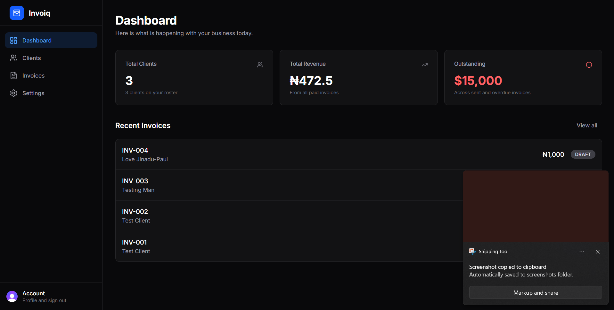
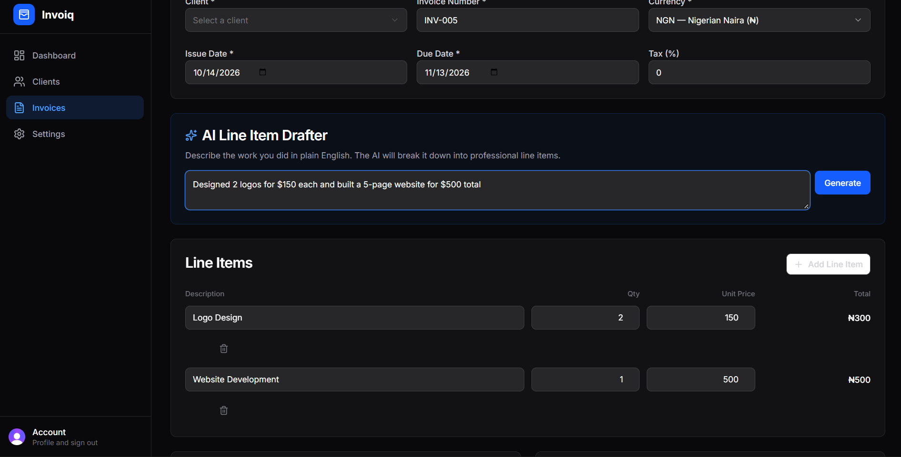
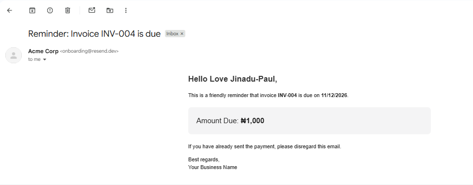

# Invoiq 💸

**Stop chasing payments. Let AI draft your invoices, and let automation handle the follow-ups.**

Invoiq is a full-stack SaaS invoicing and client management tool built specifically for freelance developers and creatives. It handles the boring stuff—tracking payments, sending reminders, and writing professional line items—so you can focus on the actual work. 

Built with Nigeria and the global freelance market in mind, featuring native Naira (NGN), USD, and GBP support, and seamless Flutterwave integration.

🔗 **Live Demo:** [invoiq-jl.vercel.app](https://invoiq-jl.vercel.app)

---

## 📸 App Walkthrough

### 1. The Command Center
Get a real-time pulse on your business. Track total revenue, outstanding payments, and recent invoices at a glance. No fake metrics—just real data from your database.



### 2. AI-Powered Invoicing
Hate writing professional descriptions for your invoices? Just type what you did in plain English. The AI breaks it down into perfectly formatted line items, calculates the math, and populates the table instantly.



### 3. Get Paid Instantly
Don't just send an invoice; send a payment link. Invoiq integrates with Flutterwave, allowing your clients to pay via Card, USSD, or Mobile Money directly from the invoice.

(./public/screenshots/payment2.png)
 

### 4. Automated Follow-ups
Stop sending awkward "did you get my invoice?" texts. With one click, Invoiq sends a professional, branded payment reminder directly to your client's inbox.



---

## 🛠️ Tech Stack

This project was built to demonstrate modern, production-ready full-stack development. 

**Frontend & Framework:**
* ⚡ **Next.js 14/15 (App Router)** for server components, routing, and SSR.
*  **Tailwind CSS** & **shadcn/ui** for a clean, accessible, and responsive dark-mode UI.
* 🔷 **TypeScript** for end-to-end type safety.

**Backend & Database:**
* 🗄️ **PostgreSQL** hosted on **Neon** for a scalable, serverless relational database.
* 🔺 **Prisma ORM** for type-safe database queries and seamless migrations.

**Integrations & APIs:**
* 🔐 **Clerk** for secure, multi-tenant authentication and user management.
* 🤖 **OpenRouter (Llama 3)** for AI-powered line item generation.
*  **Resend** for transactional email delivery.
* 💳 **Flutterwave** for processing real-world payments in multiple currencies.

---

## 🚀 Getting Started Locally

Want to run Invoiq on your own machine? Follow these steps:

1. **Clone the repository:**
   ```bash
   git clone https://github.com/TammyCodes29/Invoiq.git
   cd Invoiq

2. Install dependencies:
    ```bash
   npm install
3. Set up Environment Variables:
   Create a .env file in the root directory and add the following keys (you'll need to set up free accounts for each service):

   DATABASE_URL="your_neon_postgres_url"

    NEXT_PUBLIC_CLERK_PUBLISHABLE_KEY="pk_test_..."
    CLERK_SECRET_KEY="sk_test_..."
    
    RESEND_API_KEY="re_..."
    OPENROUTER_API_KEY="sk-or-..."
    NEXT_PUBLIC_FLUTTERWAVE_PUBLIC_KEY="FLWPUBK_TEST-..."
4. Push the Prisma Schema:
   ```bash
   npx prisma db push
   npx prisma generate
5. Run the development server:
     ```bash
   npm run dev

Open http://localhost:3000 to see the app in action.


What I Learned

Building Invoiq was a deep dive into modern SaaS architecture. Key takeaways include:

- Multi-tenancy: Designing a database schema where every query is strictly scoped to the logged-in user to prevent data leaks.
- Server Actions vs. API Routes: Leveraging Next.js Server Actions for cleaner, type-safe form submissions without the boilerplate of traditional REST endpoints.
- AI Integration: Prompt engineering and handling unpredictable JSON responses from LLMs safely using Zod and strict parsing logic.
- Production Realities: Navigating real-world deployment hurdles like Vercel build caching, Prisma generation on serverless environments, and handling deprecated AI model names.
